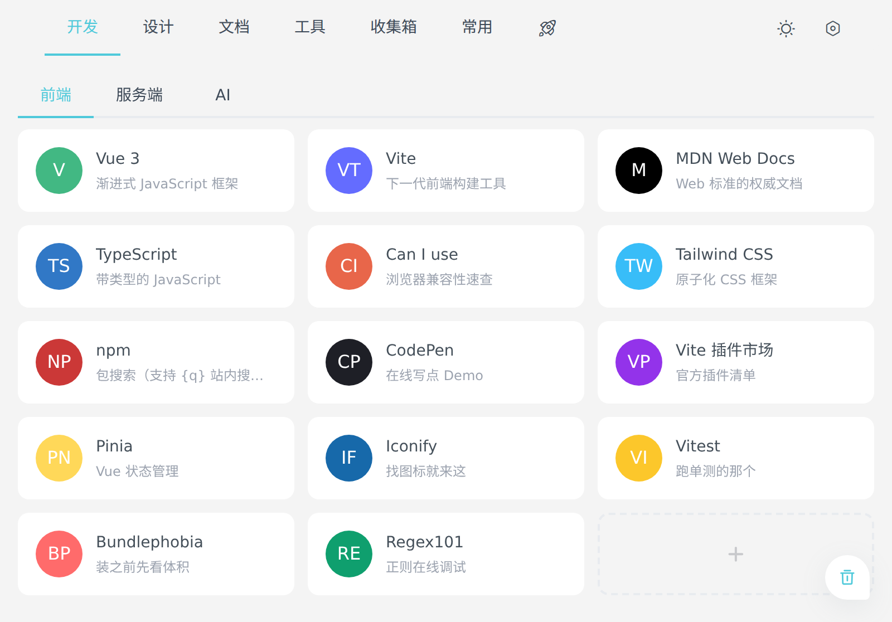
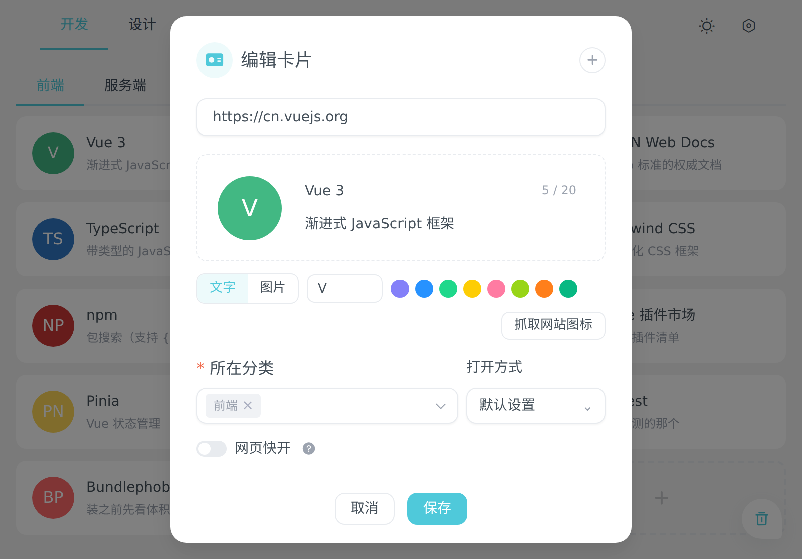
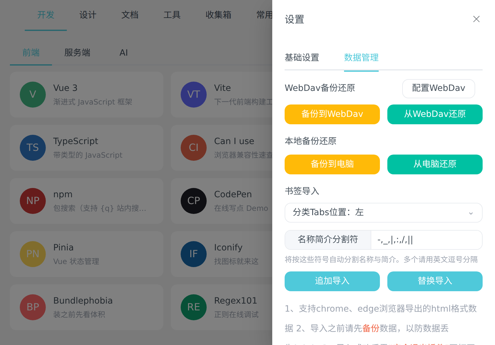
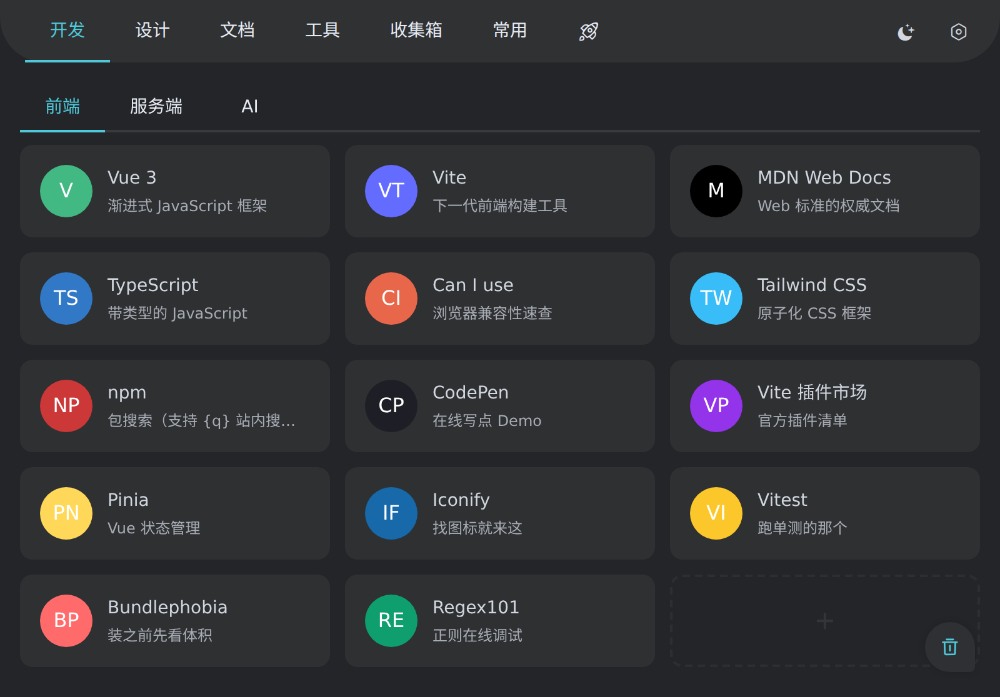

# 一链即达 · FunLink

[产品主页](https://farfarfun.github.io/packages/utools-funlink/) · 原名「网址收藏」

FunLink 是一个面向 uTools 的网址收藏与快速访问插件。它把零散书签整理成清晰的网址导航，并将收藏、搜索和打开网页串联到 uTools 主搜索框中，适合管理工作入口、开发文档、设计素材和常用在线工具。

<p align="center"></p>

插件无需账号或独立服务端，数据保存在 uTools `dbStorage` 中。项目使用 Vue 3、Composition API 和 Vite 构建，并通过独立组件与 composable 组织界面和业务状态。

## UPXS 安装与发布

从 [v1.0.1 Release](https://github.com/farfarfun-utools/utools-funlink/releases/tag/v1.0.1) 下载 `utools-funlink-1.0.1.upxs`，导入 uTools 测试。也可在成功的 CI 中下载 `utools-funlink-upxs-preview` 附件。打包链路已由用户在 FunCalc 上验证；本插件的实机安装与功能仍需分别确认。

项目根目录 [`identity.json`](identity.json) 明文维护官方项目 ID `zvghtljr`。`mid`、`uid`、`cellphone` 由 `farfarfun-utools` 组织的 `UTOOLS_MID`、`UTOOLS_UID`、`UTOOLS_CELLPHONE` Secrets 注入，不写入公开配置。CI 和 Release 统一调用固定版本的 [utools-devtools](https://github.com/farfarfun-action/utools-devtools)，生成 `.upxs` 与 `SHA256SUMS`，PR 不执行身份打包。

## 截图

| | |
| --- | --- |
|  |  |
| 一级分类在顶部，二级分类在下面一排，卡片可拖拽排序 | 图标、分类、打开方式、网页快开都在同一个面板里 |
|  |  |
| WebDav / 本地备份还原，以及浏览器书签导入 | 浅色 / 深色 / 跟随系统 |

> 图由 `pnpm screenshots` 生成，收藏都是为截图造的演示数据。

## 主要功能

### 网址管理

- 新增、编辑和删除网址卡片
- 一级分类、二级分类及卡片拖拽排序
- 常用网址、收集箱和废纸篓
- 删除后可恢复，清空废纸篓时才会永久删除
- 为网址记录独立笔记
- 为卡片设置文字图标（文字 + 底色）或本地图片图标（最大 200KB）
- 添加卡片时自动去该网站取一张图标，取不到就保留文字图标（可在设置里关掉）
- 编辑卡片时可手动点「抓取网站图标」换一张；设置 → 数据里可为存量卡片批量抓取
- 为卡片指定打开方式：系统浏览器、内置浏览器或具体的 Chrome / Edge / Firefox / Safari
- 一张卡片可附加多个网址，点击后一并打开

### uTools 联动

- 输入 `一链即达`、`FunLink`、`网址收藏`、`网址导航` 或 `web` 打开插件
- 在 uTools 主搜索框粘贴网址，直接进入添加流程
- 从 uTools 搜索面板检索收藏的网址，无需先进入插件（结果显示卡片自己的图标）
- 将卡片设为“网页快开”后，可通过网址名称直接打开
- 网址中使用 `{q}` 作为占位符，可创建站内搜索入口

例如：

```text
https://www.bing.com/search?q={q}
```

### AI 与 MCP

插件向 AI 暴露了四个工具，`utools.ai()` 的 Function Calling 和用户开启 uTools MCP 服务后的
第三方 AI Agent 都能调用：

| 工具 | 作用 |
| --- | --- |
| `search_bookmarks` | 按关键词搜收藏，返回标题、网址、简介和分类 |
| `list_categories` | 列出分类及各分类下的网址数 |
| `add_bookmark` | 收藏一个网址，已收藏过的不会重复添加 |
| `open_bookmark` | 打开已收藏的网址，站内搜索类网址需带 `query` |

工具只提供查、增、打开三类能力。删除卡片、清空废纸篓、恢复备份这类破坏性操作不对外开放：
Agent 调用时机不在用户视野里，误删整库的代价远大于省下的几次点击。

### 数据与外观

- 导出和恢复 FunLink JSON 备份，或备份到 WebDav
- WebDav 只接受 HTTPS 地址，备份文件操作限定在 FunLink 专用目录
- 直接恢复「网址精灵」导出的备份（`{ db, flyDb }` 格式），分类层级、二级 Tabs 位置、
  排序、废纸篓、收集箱、笔记、网页快开和基础设置都会一并迁移
- 导入 Chrome、Edge、Firefox 导出的 HTML 书签，可按分隔符自动拆出名称与简介
- 批量检查失效链接，并维护忽略名单
- 为存量卡片批量抓取网站图标，开始前会算出剩余空间还够放多少张，装不下就停下来
- 支持浅色、深色和跟随系统主题
- 适配 uTools 常用窗口尺寸及窄窗口布局

### 隐私

插件不会把收藏内容发送到任何第三方服务。卡片图标不走任何第三方 favicon 服务：
自动抓取时只请求你收藏的那个站点本身（页面里声明的图标和 `/favicon.ico`），
抓到的图压缩后存在本地，之后渲染卡片不再联网。不想抓的话在设置里关掉「自动抓取图标」即可。

主动联网的地方只有四处：添加卡片时抓图标（可关闭）、批量 / 手动抓取图标、
WebDav 备份/还原、「检查无效链接」，后三项都要用户显式触发。

## 使用方式

1. 运行 `sh build.sh`。
2. 打开 uTools 的“开发者工具”插件。
3. 选择“新建项目”，载入 `utools/plugin.json`。
4. 运行项目后，通过 uTools 搜索 `一链即达` 或 `FunLink` 进入插件。

插件根目录是 `utools/`：`plugin.json` 及其引用的 `preload.js`、`logo.png`、
构建产物 `dist/` 都在这一层，目录内不含 `.git`，可直接用于 uTools 打包。

插件内可直接点击卡片打开网址，点击卡片图标记录笔记，右键卡片可追加、编辑、加入常用、设置网页快开、复制链接或移到废纸篓。
搜索直接使用 uTools 的子输入框，无需先聚焦。

## 开发

```bash
pnpm install
pnpm dev
pnpm screenshots   # 重新生成 README 里的截图，没装 Chrome 会跳过
```

访问终端输出的本地地址。浏览器预览使用 `localStorage`，在 uTools 中运行时自动切换为 `dbStorage`。

### 数据兼容

存档键为 `funlink-state-v1`。读取时会自动把旧版本的字段补齐为当前结构（例如卡片只有 `categoryId` 的情况）。
若存档确实无法解析，插件会显示提示并**暂停写入**，避免覆盖掉原有数据——此时可以从备份恢复，或手动选择重置。

主要目录：

- `src/components/`：导航、网址卡片和各类对话框
- `src/composables/useFunLink.ts`：收藏状态、数据操作和 uTools 生命周期
- `src/lib/core.ts`：URL、搜索、排序、书签解析等纯函数
- `src/lib/state.ts`：存档校验、旧版本数据迁移与默认值补齐
- `src/lib/legacy.ts`：「网址精灵」备份格式的转换（示例数据也走同一套转换）
- `src/lib/storage.ts`：dbStorage / localStorage 的统一读写
- `utools/`：uTools 插件根目录（`plugin.json`、`preload.js`、图标、构建产物 `dist/`、`build.sh`）
- `utools/preload.js`：文件读写、WebDav、网站图标抓取与指定浏览器打开能力
- `build.sh`：一条命令完成校验与构建

生产构建输出到 `utools/dist/`：

```bash
pnpm build
```

## 测试

```bash
pnpm test
sh build.sh           # 含测试、preload 与 plugin.json 校验、产物自检
```

## 致谢

FunLink 的产品思路和主要交互参考了 uTools 插件 [网址精灵](https://www.u-tools.cn/plugins/detail/%E7%BD%91%E5%9D%80%E7%B2%BE%E7%81%B5/)（作者：呀唔咪）。感谢原作者对网址收藏、分类导航和网页快开工作流的探索与分享。

本项目为独立复刻实现，不隶属于原插件或原作者。

---

## 关于 farfarfun-utools

[farfarfun](https://github.com/farfarfun) 的 uTools 插件产品线：本地优先、集成 uTools
主搜索框、统一 Vue 3 + Vite 技术栈。

- 🏠 组织主页：<https://github.com/farfarfun-utools>
- 📧 联系：farfarfun@qq.com

本项目基于 [MIT](LICENSE) 协议开源。
